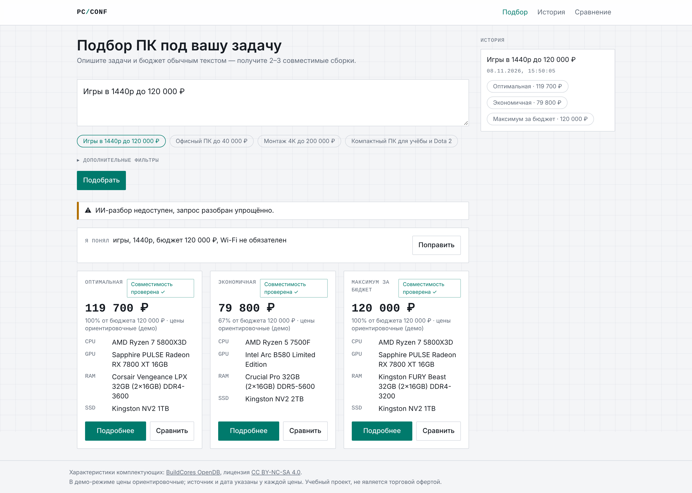
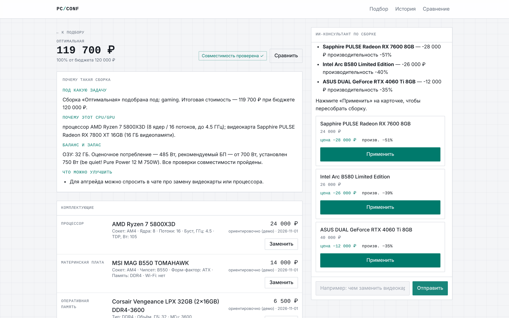
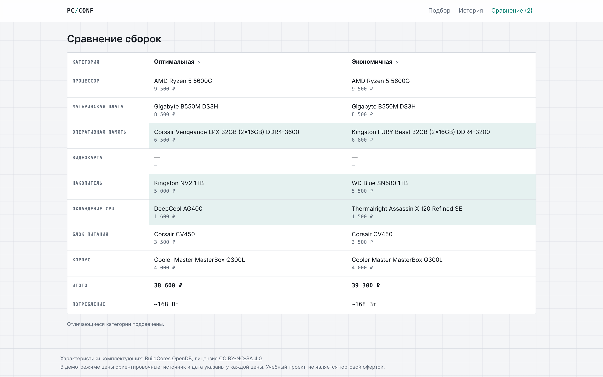

# AI PC Configuration

## Запуск

```bash
cp .env.example .env      # при желании впишите OPENROUTER_API_KEY и LLM_MODEL
docker compose up --build
```

- Frontend: http://localhost:5173
- Backend / OpenAPI: http://localhost:8000/docs
- Health: http://localhost:8000/api/v1/health

При первом запуске backend сам применяет миграции, загружает демо-каталог (`scripts/seed_demo.py`)
и считает эмбеддинги. **Без ключа OpenRouter всё работает** через детерминированный fallback-парсер
и шаблонные объяснения (в ответе `/configure` будет `warnings: ["llm_unavailable"]`).

## Как это работает

Текст → разбор (LLM со схемой + regex-парсер) → распределение бюджета по профилям → отбор
кандидатов → beam search с жёсткими правилами совместимости → скоринг → 2–3 разных сборки →
объяснение LLM с проверкой на «галлюцинации». Подробно: [docs/ARCHITECTURE.md](docs/ARCHITECTURE.md),
контракт API: [docs/API.md](docs/API.md), результаты оценки: [docs/EVAL_REPORT.md](docs/EVAL_REPORT.md).

## Каталог и данные

| Источник | Команда |
|---|---|
| Демо-каталог (без сети, ~108 моделей, цены ориентировочные) | `python scripts/seed_demo.py` |
| BuildCores OpenDB | `python scripts/import_opendb.py --path <клон репозитория>` (или `--download`) |
| Прайс CSV (`sku_or_name,price_rub,in_stock,source,updated_at`) | `python scripts/import_prices.py prices.csv` |
| Эмбеддинги | `python scripts/build_embeddings.py` |

У OpenDB нет цен: после импорта загрузите прайс, иначе компоненты не попадут в подбор.
Скрипты запускаются из каталога `backend/` (`DATABASE_URL` из `.env`).

## Разработка

```bash
make check                                   # ruff + mypy + pytest, eslint + prettier + vitest + build
cd backend && python eval/run_eval.py        # оценка на 30 запросах -> docs/EVAL_REPORT.md
cd frontend && npm run gen:api               # типы из backend/openapi.json
```

Тесты не ходят в сеть и LLM: они опираются на демо-каталог и мок-клиент.

## Деплой на VPS

1. Docker + compose plugin на сервере, клонировать репозиторий.
2. `cp .env.example .env`, задать `POSTGRES_PASSWORD`, `CORS_ORIGINS=https://ваш-домен`,
   при необходимости `OPENROUTER_API_KEY` и `LLM_MODEL`.
3. `docker compose -f docker-compose.prod.yml --env-file .env up -d --build`
4. Сайт — порт 80 (nginx отдаёт фронтенд и проксирует `/api/` с отключённой буферизацией для SSE).
   Для HTTPS поставьте перед ним Caddy/Traefik или certbot.

## Скриншоты

| Подбор (1440 px) | Сборка + чат | Сравнение |
|---|---|---|
|  |  |  |

Мобильная версия (360 px): [подбор](docs/screenshots/home-mobile-360.png),
[сборка](docs/screenshots/build-mobile-360.png).

## Атрибуция и лицензии

Характеристики комплектующих: [BuildCores OpenDB](https://github.com/buildcores/buildcores-open-db),
лицензия **CC BY-NC-SA 4.0** (не ODC-By, как было в ТЗ — см. [docs/KNOWN_ISSUES.md](docs/KNOWN_ISSUES.md)):
некоммерческое использование, с указанием авторства и распространением производных данных на тех же
условиях. Демо-каталог составлен вручную; цены в нём ориентировочные.
